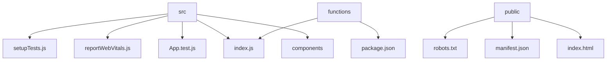

# FreeShare: File Sharing Platform

## 🗂️ Description

FreeShare is a file sharing platform built with React, Firebase, and Cloud Functions. This project allows users to share files easily and efficiently. It's designed for individuals and teams who need a simple and secure way to share files.

The platform provides a user-friendly interface for uploading, sharing, and managing files. With FreeShare, you can share files with others by generating a unique link, and recipients can access the files without needing to create an account.

## ✨ Key Features

### **File Sharing**
* Upload and share files with others via a unique link
* Supports various file types, including documents, images, and videos

### **Security and Authentication**
* Secure file storage using Firebase Storage
* Authentication and authorization using Firebase Authentication

### **User Interface**
* Responsive and user-friendly interface built with React and Material-UI
* Easy navigation and file management

## 🗂️ Folder Structure

## 🛠️ Tech Stack

## ⚙️ Setup Instructions

To run the project locally, follow these steps:

* Git clone the repository: `https://github.com/Varshithvhegde/FreeShare.git`
* Install dependencies: `npm install`
* Start the development server: `npm start`
* Open `http://localhost:3000` in your browser to access the application

## 📈 GitHub Actions

The project uses a GitHub Actions workflow to automate tasks. However, the current workflow configuration (`jekyll-gh-pages.yml`) appears to be a leftover and is not used in this project.

## 📁 Configuration Files

The project uses several configuration files:

* `.firebaserc`: Firebase configuration file
* `firebase.json`: Firebase Cloud Functions configuration file
* `.github/workflows/jekyll-gh-pages.yml`: GitHub Actions workflow configuration file (not used)
* `.gitignore`: Git ignore file
* `functions/.gitignore`: Git ignore file for Cloud Functions
* `functions/.eslintrc.js`: ESLint configuration file for Cloud Functions
* `package.json`: Project dependencies and scripts
* `functions/package.json`: Cloud Functions dependencies and scripts

  

<h3>Varshith V Hegde</h3>

A programmer fond of learning

 

  <a href="https://gitfull.vercel.app">Made by GitFull</a>

    